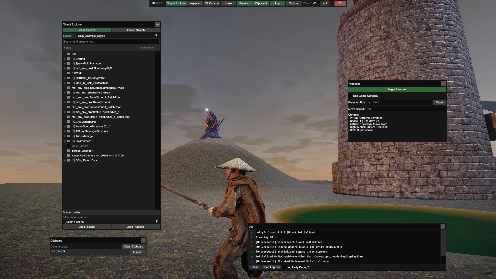
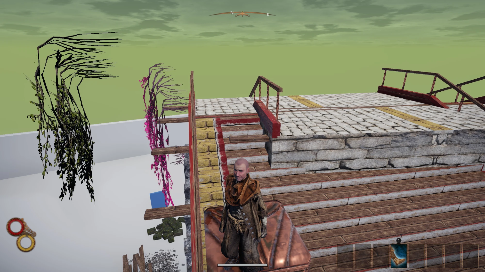
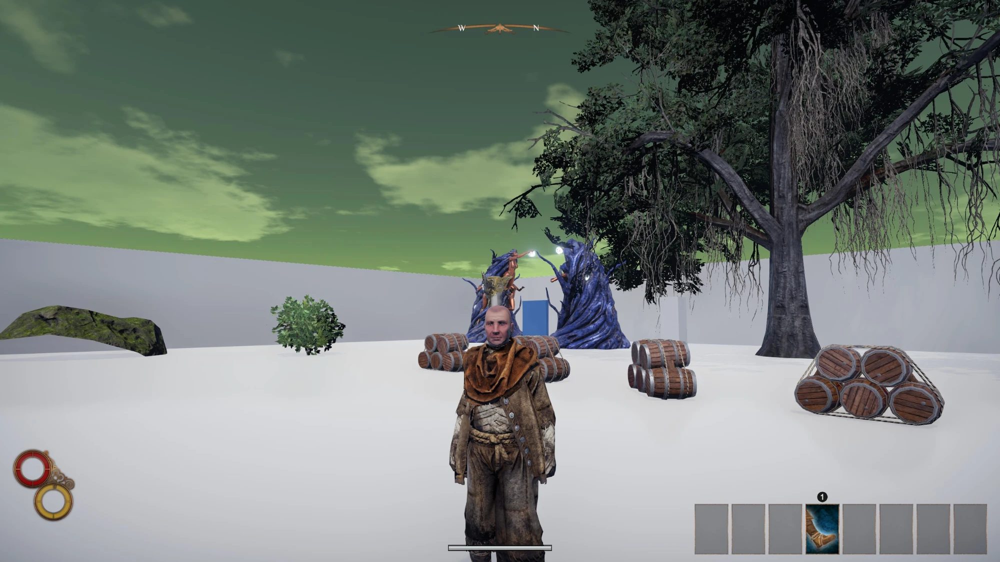

# Outward Construction Kit

A new era for Outward modding! Now we can add new regions and dungeons to the game. Walk through a door, get a real loading screen, and arrive somewhere new, built from the game's own props, enemies, water and terrain textures. Adds new regions to Outward: Definitive Edition.

**This is a beta.** This mod does nothing by itself: it loads region mods, and lets you make your own.

## For players

Install [r2modman](https://thunderstore.io/package/ebkr/r2modman/), choose Outward: Definitive Edition, create a profile, and install a region mod from its **Online** tab. This kit and BepInEx, which runs mods, come with it. Start the game with r2modman's **Start modded** button, because Steam's own Play button starts it without mods.

Each region's page says where to find its door. Walk up to the door and use it, like any other door in the game.

The first launch after installing a region takes a little longer, while the kit prepares what that region uses from your own copy of the game. It keeps the results in `BepInEx/OCK_Cache`, which is always safe to delete.

If you uninstall a region while your character is inside it, you'll arrive back where you entered it, as long as the kit stays installed. Don't uninstall the kit itself while inside a region.

## For modders

Regions are made in Unity 2020.3.26f1, with the free starter project and guides on [GitHub](https://github.com/Robin-Rounthwaite/Outward-Construction-Kit). You place vanilla props and enemies, sculpt and paint ground, add water, and export. Anything you only move, rotate or evenly scale stays a reference to the player's own game files, so no art ships in your mod.

## Current limitations

- Co-op hasn't been tested yet.
- Only Outward: Definitive Edition on Windows is supported.
- Props are decoration for now: chests and gathering spots don't work. Items placed from the Items tab are real, and can be picked up.
- Dying in a region always returns you to where you entered it. There are no defeat scenarios yet.
- A game update can stop a region's references from matching. The game then shows a notice on screen, and the log has the details.

## Screenshots

## Reporting problems

Please open an issue on [GitHub](https://github.com/Robin-Rounthwaite/Outward-Construction-Kit/issues), with your `BepInEx/LogOutput.log` attached.

## Use of AI

Claude Code was used in the making of this mod.
